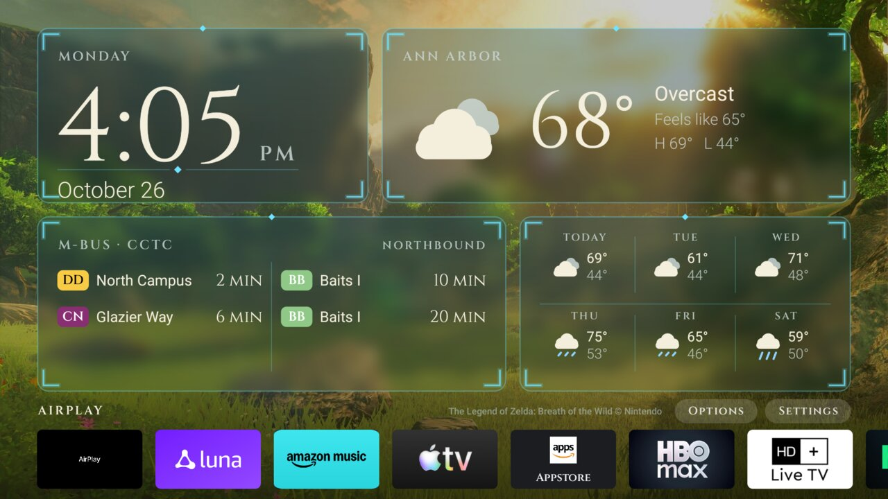
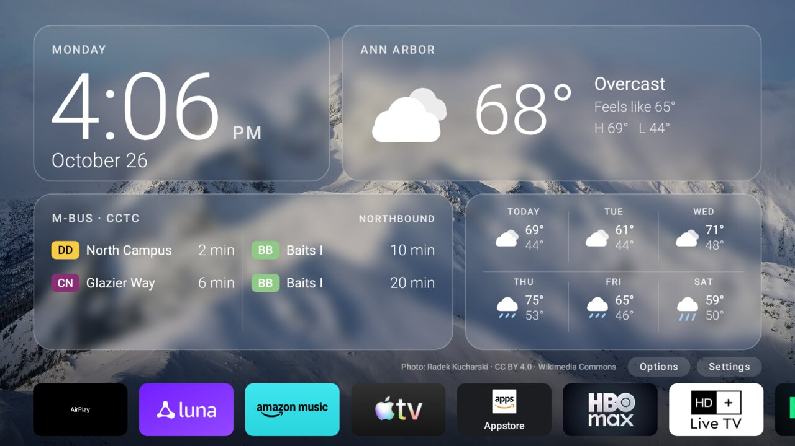
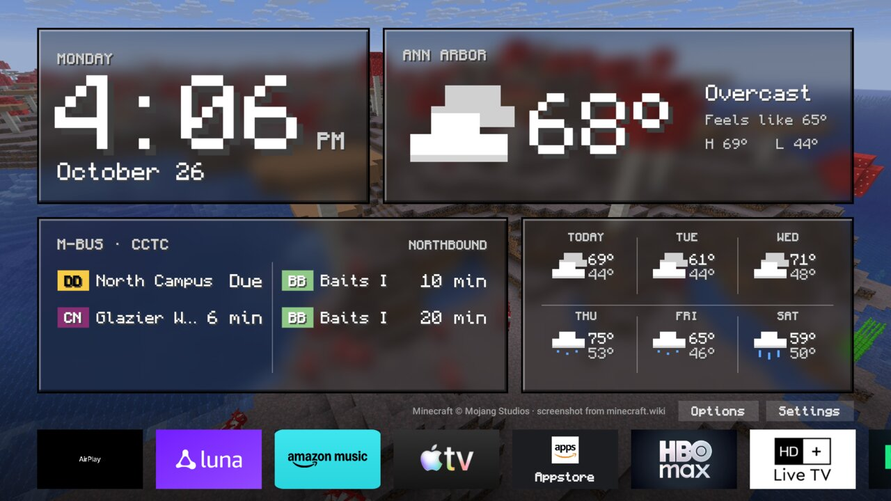
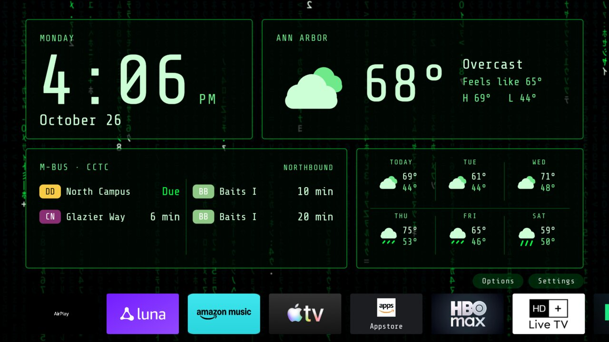
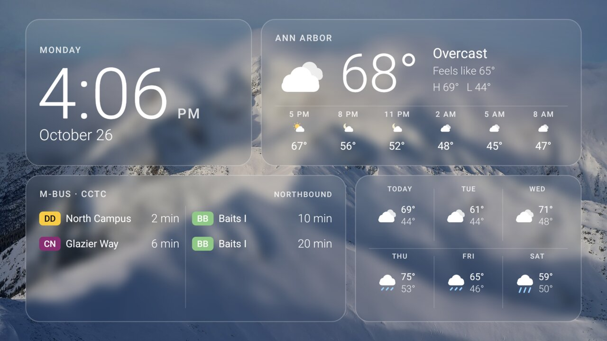

# Hyrule Home

A themed widget launcher for a Fire TV Edition television, built on top of
[**dumbtv**](https://github.com/humblemuzzu/dumbtv) by
[@humblemuzzu](https://github.com/humblemuzzu) and its contributors.

<p align="center">
  
</p>

> **Credit where it's due.** The work that strips Amazon's ads and tracking off the TV
> (the debloat scripts, DNS filter setup, device catalog, docs and the original
> *dumbtv home* launcher) comes from the [dumbtv project](https://github.com/humblemuzzu/dumbtv).
> This repository started as a copy of dumbtv and keeps its full commit history, so every
> upstream author is still credited on their own commits. My part is the launcher rework
> described below. dumbtv is MIT-licensed, and so is this repository ([LICENSE](LICENSE)).

## Background

Our living-room TV is an Insignia Fire TV Edition set running Fire OS 8. Out of the box,
Amazon's home screen is built around sponsored rows and ads. I started with dumbtv's
cleanup, which runs over ADB with no root. It disables Amazon's ad, telemetry and
screen-fingerprinting packages, runs a DNS filter on the TV, and replaces Amazon's home
screen with dumbtv home, a minimal launcher that shows only your apps and HDMI inputs.

Then I turned that launcher into **Hyrule Home**. It adds a board of widgets (time,
weather, a forecast and live University of Michigan bus arrivals), switchable themes and a
screensaver. It keeps dumbtv home's package name (`tv.dumbtv.home`), so dumbtv's own
`launcher.sh`, `verify.sh` and `restore.sh` still install, check and undo it.

## Themes

| Hyrule | Landscape |
|---|---|
|  |  |
| **Minecraft** | **Matrix** |
|  |  |

- **Hyrule:** *Breath of the Wild* scenery, Cinzel type and ornamented glass cards.
- **Landscape:** CC-licensed mountain and lake photos from Wikimedia Commons, under clean frosted glass.
- **Minecraft:** biome screenshots and the Monocraft pixel font.
- **Matrix:** falling green code drawn live on black, with no pictures.

Backgrounds rotate (`rotate=hourly`) and are dimmed behind the cards. You switch themes
from the remote, in Options.

### Screensaver

The same live widgets also run as the TV's screensaver, full screen and without the app
row. The first remote press dismisses it without opening anything.



## What I added

- **Widget board.** The top 80% of the screen is a 12×6 grid. One line in `home.conf`
  lays out the widgets (`widgets=time:5x4,weather:7x4,forecast:12x2`), with sizes, pinned
  positions and automatic packing. The bottom 20% is one scrolling dock of apps and HDMI
  inputs.
- **Widgets:**
  - time and date
  - current weather with an 18-hour strip, and a six-day forecast (both from
    [Open-Meteo](https://open-meteo.com), which needs no key)
  - free memory
  - **M-Bus**, the next University of Michigan buses at a stop. The client talks to the
    Clever Devices BusTime v3 API, including the public map's HMAC-SHA256 signed requests.
    It syncs with the server's clock, so a wrong TV clock or time zone doesn't break
    authentication.
- **Themes.** A `Theme` class sets the card glass, colors, fonts, ornaments and
  background. A new theme is one factory method plus a picture folder.
- **Screensaver** (`tv.dumbtv.home/.Screensaver`). Its installer saves the TV's previous
  screensaver and restores it on `--undo`.
- **Easy to extend.** A new widget is one subclass of `Widget` plus one line in
  `Widgets.java`; see [launcher/WIDGETS.md](launcher/WIDGETS.md).
- Still plain Java and Android views, with no libraries. Unlike stock dumbtv home, it asks
  for the `INTERNET` permission, which it uses only for weather and bus data.

Tests: Java host tests cover the board layout and the M-Bus request signing and run
without a device. They sit on top of dumbtv's Python suite, which runs the scripts against
a fake TV.

## Build and install

You need a JDK 17, the Android SDK (`platforms;android-25`, `build-tools;34.0.0`) and
`adb`. On the TV, turn on ADB debugging: Settings → My Fire TV → About, press OK on the
device name 7 times, then open Developer Options.

```sh
adb connect <tv-ip>:5555                               # press Allow on the TV
ADB_SERIAL=<tv-ip>:5555 ./launcher/install.sh --build  # build, sign, install, take over HOME
./launcher/screensaver.sh                              # optional: use it as the screensaver
```

Settings live in `launcher/themes/home.conf` (theme, widgets, weather location). Put
private values such as the M-Bus API key in `launcher/themes/home.local.conf`, which git
ignores. `install.sh --undo` and `scripts/restore.sh` put everything back.

To clean up the TV itself first, follow dumbtv's guide: [AGENTS.md](AGENTS.md), then
`./scripts/preflight.sh`, `./scripts/all.sh` and `./scripts/verify.sh`. That part is
unchanged from upstream, and its documentation is in [docs/](docs/) and at
[dumbtv.org](https://dumbtv.org).

## Repository layout

| Path | What | From |
|---|---|---|
| `launcher/` | Hyrule Home: Java source, themes, fonts, installer | dumbtv home, reworked here |
| `launcher/WIDGETS.md` | arranging and writing widgets, adding themes | here |
| `HANDOFF.md` | project notes and lessons learned on this TV | here |
| `scripts/`, `data/`, `catalog/`, `docs/`, `tests/` | the TV cleanup, its lists, device reports and tests | [dumbtv](https://github.com/humblemuzzu/dumbtv) |

## Credits

- **[dumbtv](https://github.com/humblemuzzu/dumbtv)** by
  [Muzammil (@humblemuzzu)](https://github.com/humblemuzzu) and
  [its contributors](https://github.com/humblemuzzu/dumbtv/graphs/contributors): the
  cleanup scripts, the device catalog, and the original dumbtv home launcher this one
  builds on. For the cleanup itself, use upstream.
- dumbtv builds on [personalDNSfilter](https://github.com/IngoZenz/personaldnsfilter),
  [HaGeZi's DNS blocklists](https://github.com/hagezi/dns-blocklists) and
  [SmartTube](https://github.com/yuliskov/SmartTube).
- Fonts: Cinzel, Monocraft, Noto Sans JP and Share Tech Mono, under the SIL Open Font
  License (`launcher/assets/fonts/`).
- Wallpapers: *The Legend of Zelda: Breath of the Wild* © Nintendo; Minecraft © Mojang
  Studios (screenshots from minecraft.wiki); landscape photos by their Wikimedia Commons
  authors under CC BY or CC BY-SA, each listed in its theme's `credits.txt`. The game
  screenshots belong to their owners and are included for personal, non-commercial use.
- Weather data from [Open-Meteo](https://open-meteo.com). Bus data from the University of
  Michigan's Magic Bus system.

## Legal

This is a personal project. It is not affiliated with or endorsed by Amazon, Nintendo,
Mojang, Microsoft or the University of Michigan. Fire TV and Fire OS are trademarks of
Amazon. The code is [MIT](LICENSE); the device catalog is [CC BY-SA 4.0](catalog/LICENSE).
